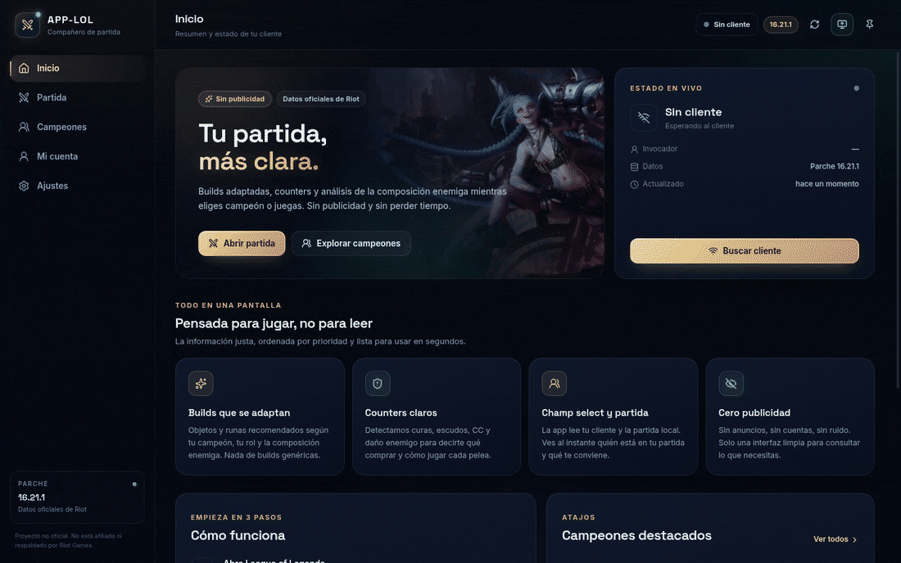
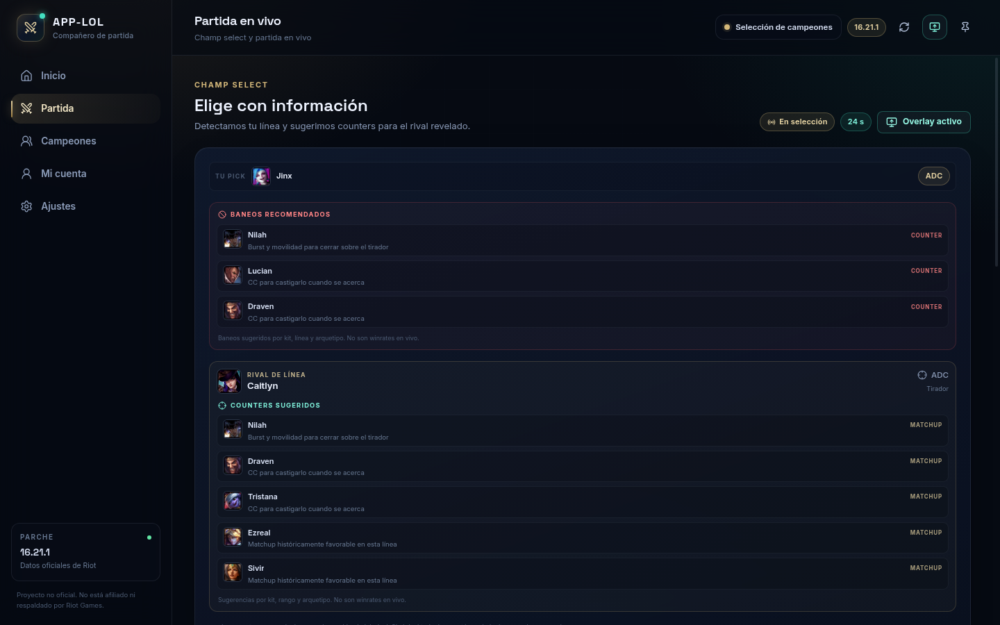
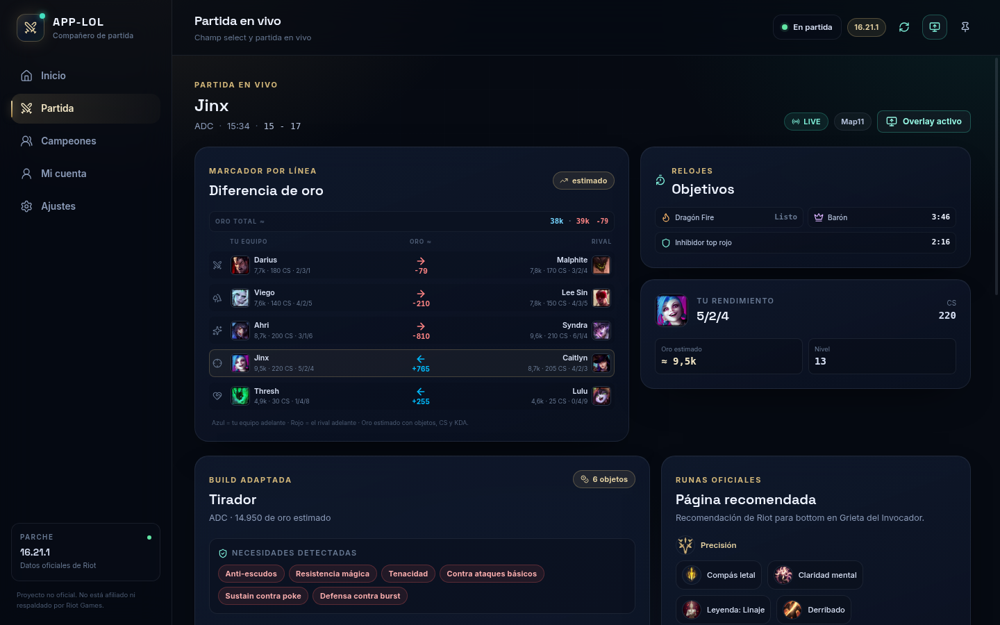
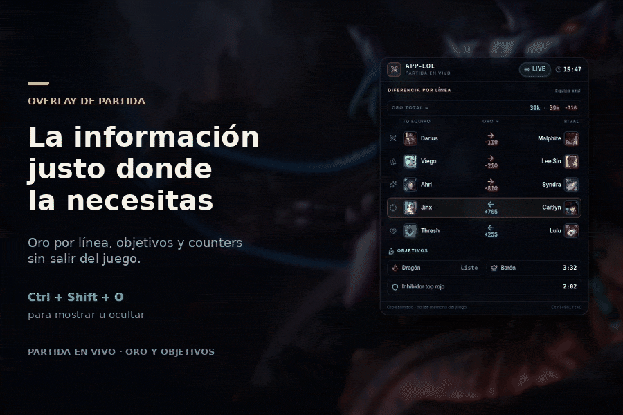

# App-LOL

Compañero de escritorio para League of Legends. Reúne builds, counters, runas, datos del cliente y un overlay de partida en una sola app, sin publicidad y sin pedir tu cuenta de Riot.


> Proyecto personal, no afiliado ni respaldado por Riot Games. League of Legends y sus activos son propiedad de Riot Games, Inc.

**[Descargar el instalador para Windows](https://github.com/ryodan14/App-LOL/releases/latest/download/App-LOL-Setup-x64.exe)** · [Todas las versiones](https://github.com/ryodan14/App-LOL/releases)

<p align="center">
  
</p>

<details>
<summary><strong>Ver capturas de la app</strong></summary>

### Champ select



### Partida en vivo



</details>

## Características

- **Datos oficiales**: campeones, objetos, hechizos, runas y recomendaciones desde Data Dragon y Community Dragon. El parche se detecta automáticamente y se guarda en caché local.
- **Análisis de builds**: build recomendada por campeón y rol, runas, hechizos de invocador y counters directos.
- **Champ select**: composición aliada y enemiga, picks, bans, counters, baneos recomendados para tu pick y temporizador.
- **Partida en vivo**: KDA, CS, objetos, nivel, oro estimado por personaje y diferencia total y por línea, además de timers de objetivos.
- **Idiomas**: interfaz y datos de Riot en español, inglés o portugués de Brasil, con selector en Ajustes.
- **Overlay click-through y personalizable**: se muestra solo en champ select, partida o reconexión. Incluye counters, baneos recomendados, oro por línea y timers. No roba foco ni clics; puedes cambiar tamaño, transparencia, posición y secciones visibles.
- **Mi cuenta**: perfil, nivel, icono, rangos de Solo/Dúo y Flex, LP, winrate y maestría de campeones.
- **Inicio automático**: arranca con Windows, queda en la bandeja y aparece al abrir League.
- **Sin credenciales**: usa únicamente las APIs locales del cliente. No hay login, cuentas ni servidores propios.

## Requisitos

### Para usar la app

- Windows 10 u 11 de 64 bits.
- League of Legends instalado.
- Conexión a internet la primera vez, para descargar los datos del parche.
- No requiere permisos de administrador.

### Para desarrollar

- Node.js 22 o superior.
- npm 10 o superior.
- Git.

## Descarga

Los ejecutables están publicados en [GitHub Releases](https://github.com/ryodan14/App-LOL/releases/latest), así no dependes de tenerlos solo en el Escritorio. Los enlaces de descarga apuntan siempre a la última versión publicada.

- **Instalador recomendado**: [App-LOL-Setup-x64.exe](https://github.com/ryodan14/App-LOL/releases/latest/download/App-LOL-Setup-x64.exe). Instala la app, crea accesos directos en el Escritorio y el menú Inicio, y la abre al terminar.
- **Portátil**: [App-LOL-Portable-x64.exe](https://github.com/ryodan14/App-LOL/releases/latest/download/App-LOL-Portable-x64.exe). No requiere instalación.

Al abrir la app por primera vez, queda configurada para iniciar con Windows y aparecer cuando abres League of Legends. Puedes cambiar ambas opciones en **Ajustes → Sistema**.

## Instalación en Windows

La app se distribuye de dos formas: instalador con accesos directos o ejecutable portátil.

### Opción A: instalador

1. Ejecuta `App-LOL-Setup-x64.exe`.
2. Elige la carpeta de instalación si quieres cambiarla.
3. El instalador crea accesos directos en el escritorio y en el menú Inicio.
4. Al terminar, App-LOL se abre automáticamente.

### Opción B: portátil

1. Ejecuta `App-LOL-Portable-x64.exe`.
2. La app extrae sus archivos a una carpeta temporal y se ejecuta desde allí.
3. Puedes mover o renombrar el ejecutable, pero no lo borres mientras la app está abierta.

### Aviso de SmartScreen

Los ejecutables no están firmados digitalmente, así que Windows puede mostrar un aviso de SmartScreen. Si descargaste el archivo desde este repositorio o lo compilaste tú, usa **Más información → Ejecutar de todas formas**.

## Actualizaciones

La versión instalada comprueba si hay una versión nueva al abrir la app y cada 6 horas. La actualización se descarga en segundo plano y se instala al cerrar o reiniciar App-LOL. También puedes comprobarla manualmente en **Ajustes → Actualizaciones**.

> **Importante**: App-LOL 0.1.0 no incluye el actualizador y no puede actualizarse sola. Si ya lo tenías instalado, descarga e instala una vez la 0.2.0 desde GitHub Releases. A partir de ahí las siguientes actualizaciones serán automáticas.

La **versión portátil no se actualiza sola**: descarga el ejecutable nuevo desde la última release. Las actualizaciones automáticas están disponibles en la versión instalada de Windows.

Las versiones se publican como releases de GitHub. El instalador se actualiza con `latest.yml` y los usuarios no tienen que volver a descargar nada.

## Primer uso

1. Abre App-LOL.
2. Abre League of Legends. La app detecta el cliente automáticamente y trae tu perfil.
3. Si ya estás en champ select o en partida, entra en **Partida** para ver el análisis en vivo.
4. En **Ajustes** puedes configurar el inicio con Windows, el overlay y la conexión manual con el cliente.

La primera carga descarga los datos del parche. Las siguientes aperturas usan la caché local y son más rápidas.

## Páginas

### Inicio

Resumen del estado del cliente, acceso rápido a partida y campeones destacados. Si no hay partida activa, muestra el estado actual y atajos para empezar.

### Partida

Champ select y partida en vivo:

- Aliados, enemigos, picks, bans y roles.
- Counters y sugerencias de build.
- Baneos recomendados cuando ya elegiste tu campeón.
- KDA, CS, nivel, objetos y hechizos.
- Oro estimado por personaje, diferencia total del equipo y diferencia por línea.
- Timers de objetivos.
- Botón para mostrar u ocultar el overlay.

### Campeones

Buscador y filtros por rol, con detalle de cada campeón: estadísticas, habilidades, pasiva, lore, builds, runas y counters.

### Mi cuenta

Perfil del invocador, nivel, icono, rangos de Solo/Dúo y Flex 5v5, LP, winrate combinado, rachas y maestría de los campeones más jugados.

Los datos de la cuenta se leen del cliente local. Si League está cerrado, la página muestra un estado vacío o un error con opción de reintentar.

### Ajustes

- Idioma de la interfaz y de los datos de Riot: español, inglés o portugués de Brasil.
- Detección automática del cliente o conexión manual por ruta, puerto y token.
- Frecuencia de actualización.
- Ventana siempre arriba, envío al segundo monitor, overlay, splash arts y reducción de animaciones.
- Inicio con Windows y aparición al abrir League.
- Estado de la caché y actualización de datos.

## Overlay

El overlay aparece sobre el monitor principal cuando estás en champ select, en partida o reconectando. Es transparente, no roba foco y deja pasar los clics al juego.

<p align="center">
  
</p>

- **Mostrar u ocultar**: `Ctrl + Shift + O`, el botón de la barra superior o el menú de la bandeja.
- **Tamaño**: en **Ajustes** puedes elegir entre 60% y 100%. Por defecto usa 80%.
- **Transparencia**: el fondo va de 35% (casi transparente) a 100% (sólido). Por defecto usa 75%.
- **Posición**: arriba o abajo, a la izquierda o derecha, o al centro lateral. La posición centrada sirve para acercar los timers al minimapa.
- **Segundo monitor**: en **Ajustes → Ventana y apariencia** puedes enviar la ventana principal al otro monitor y dejar el overlay sobre el juego.
- **Secciones**: puedes activar o desactivar el oro estimado (total y por línea), los timers de objetivos y el overlay durante champ select.
- **Oro con atajo**: si activas “Oro solo con Ctrl+Shift+G”, el panel de oro empieza oculto y lo muestras u ocultas con ese atajo. No se puede detectar la tecla Tab del juego desde la API.
- **Alcance**: counters y baneos recomendados durante champ select, oro estimado por personaje con diferencia total y por línea, y timers de objetivos.
- **Oro estimado**: se calcula con el tiempo de partida, CS, KDA y el valor de los objetos. No es el oro exacto del marcador, por eso se muestra con `≈`.
- **Pantalla completa exclusiva**: el overlay puede no verse en ese modo. Usa League en pantalla completa sin bordes o en ventana.

## Inicio con Windows y bandeja

El inicio automático y la aparición al abrir League vienen activados por defecto.

- Al iniciar sesión en Windows, App-LOL arranca oculta en la bandeja.
- Cuando se detecta el cliente de League, la ventana sale de la bandeja sin robar foco.
- Con el inicio automático activo, la **X** oculta la ventana en la bandeja. Para cerrar la app del todo, usa **Salir** en el menú de la bandeja.
- Si desactivas el inicio automático, la **X** cierra la app.
- El menú de la bandeja también permite abrir la app, activar el overlay y cambiar el inicio con Windows o la aparición al abrir League.

El inicio automático se registra en el usuario actual, no requiere administrador y se limpia al desinstalar.

## Conexión con League

Por defecto, App-LOL busca el cliente en estas ubicaciones:

```text
C:\Riot Games\League of Legends
C:\Program Files\Riot Games\League of Legends
C:\Program Files (x86)\Riot Games\League of Legends
D:\Riot Games\League of Legends
E:\Riot Games\League of Legends
```

También puede leer el proceso `LeagueClientUx.exe` y su archivo `lockfile`.

Si usas otra instalación:

1. Abre **Ajustes → League of Legends**.
2. Desactiva **Detectar el cliente automáticamente**.
3. Introduce la ruta de instalación, por ejemplo `C:\Riot Games\League of Legends`.
4. Si hace falta, completa el puerto y el token del cliente.
5. Sal del campo para guardar y usa **Volver a detectar**.

El token del cliente es local y sensible. La app no lo envía a internet. No compartas tu `lockfile` ni el token con nadie.

## Datos y privacidad

- Los datos estáticos se descargan de Data Dragon y Community Dragon, de Riot Games.
- Los datos de la partida y de la cuenta se leen de `127.0.0.1`: la API local del cliente (LCU) y la Live Client Data API en el puerto `2999`.
- No hay cuentas, telemetría, publicidad ni servidores propios.
- La caché de datos se guarda en el directorio de datos de la app dentro de tu perfil de Windows.
- La app no pide usuario ni contraseña de Riot.

## Desarrollo

```bash
git clone https://github.com/ryodan14/App-LOL.git
cd App-LOL
npm install
npm run dev
```

### Comandos

| Comando | Descripción |
| --- | --- |
| `npm run dev` | Inicia la app en modo desarrollo con recarga. |
| `npm run typecheck` | Verifica tipos del proceso principal y del renderer. |
| `npm test` | Ejecuta los tests con Vitest. |
| `npm run build` | Compila la app sin empaquetar. |
| `npm run build:win` | Genera el instalador NSIS, el portátil y `latest.yml` en `release/`. |
| `npm run build:linux` | Genera un AppImage para Linux. |

Los artefactos de Windows quedan en `release/`:

```text
release/App-LOL-Setup-x64.exe
release/App-LOL-Setup-x64.exe.blockmap
release/App-LOL-Portable-x64.exe
release/latest.yml
```

### Publicar una versión

La forma recomendada es dejar que GitHub Actions compile y publique la release:

1. Sube la versión y crea el tag: `npm version patch` (o `minor`/`major`).
2. Sube el commit y el tag:

```bash
git push origin main --follow-tags
```

3. La workflow `.github/workflows/release.yml` compila en Windows, ejecuta los tests y publica el instalador, `latest.yml` y el `.blockmap`.

Si compilas manualmente con `npm run build:win`, sube a la release el instalador, el `.blockmap`, el portátil y `latest.yml`. No publiques el instalador y el portátil por separado: todos los assets deben quedar en la misma release.

La versión de `package.json` debe coincidir con el tag. Para que las actualizaciones funcionen, la release debe ser pública y no quedar en borrador.

### Estructura

```text
src/
  main/            Proceso principal de Electron
    services/      LCU, datos estáticos, snapshots, ajustes y caché
    index.ts       Ciclo de vida, IPC, bandeja, inicio automático y atajos
    overlay.ts     Ventana del overlay
    preview.ts     Datos de prueba para capturas y QA
    window.ts      Ventana principal y persistencia de tamaño
  preload/         Puente seguro entre main y renderer
  renderer/
    src/
      pages/       Inicio, Partida, Campeones, Mi cuenta y Ajustes
      components/  Layout y componentes de UI
      overlay/     Interfaz del overlay
      store/       Estado de la app con Zustand
      lib/         Cliente IPC, formato y datos de juego
  shared/          Tipos, constantes y motor de análisis
build/             Iconos y personalización del instalador
docs/media/        Capturas y GIFs usados en el README
```

## Solución de problemas

### La app no detecta el cliente

- Verifica que League of Legends esté abierto y hayas iniciado sesión.
- Abre **Ajustes → League of Legends** y usa **Volver a detectar**.
- Si usas una instalación personalizada, desactiva la detección automática e introduce la ruta.
- Revisa que el archivo `lockfile` exista dentro de la carpeta de instalación.

### El overlay no aparece

- Activa el overlay en **Ajustes** o con `Ctrl + Shift + O`.
- El overlay solo se muestra en champ select, partida o reconexión. Verifica que “Mostrar en champ select” esté activo si no aparece al elegir campeón.
- Si el oro no aparece, usa `Ctrl + Shift + G` o desactiva “Oro solo con Ctrl+Shift+G” en Ajustes.
- En pantalla completa exclusiva puede quedar oculto. Prueba con pantalla completa sin bordes.
- Si otro programa usa `Ctrl + Shift + O` o `Ctrl + Shift + G`, cambia el foco y vuelve a intentar.

### Windows bloquea el ejecutable

Es un binario sin firma digital. Usa **Más información → Ejecutar de todas formas** si confías en el origen del archivo.

### La app no arranca o no aparece la ventana

- Si el inicio automático está activo, la app puede estar en la bandeja. Haz clic en el icono de App-LOL.
- Abre el menú de la bandeja y elige **Abrir App-LOL**.
- Si el problema persiste, cierra la app desde la bandeja con **Salir** y vuelve a abrirla.

### No cargan los datos del parche

- Revisa la conexión a internet.
- Abre **Ajustes → Datos** y usa **Actualizar datos ahora**.
- Si el parche cambió hace poco, puede tardar unos minutos en estar disponible en Data Dragon.

### Mi cuenta aparece vacía

- La página necesita que el cliente esté abierto y con sesión iniciada.
- Espera unos segundos y usa **Actualizar cuenta**.
- Si el cliente está en mantenimiento o sin conexión, los rangos y la maestría pueden no estar disponibles.

## Estado del proyecto

App-LOL está en desarrollo activo. Algunas limitaciones conocidas:

- El oro exacto de los diez jugadores no está expuesto por la API oficial; se estima y se muestra como aproximado.
- Riot no publica una lista completa de builds por campeón en Data Dragon. El orden de objetos es una recomendación heurística basada en estadísticas, arquetipo, rol y amenazas enemigas.
- No hay OCR ni lectura de pantalla.
- El overlay puede no funcionar en pantalla completa exclusiva.
- Los ejecutables no están firmados, por lo que SmartScreen puede advertir.
- La integración completa con una partida real requiere League of Legends abierto en Windows.

## Contribuir

Las mejoras se trabajan desde `develop` en ramas `feature/...`. Antes de abrir un cambio:

```bash
npm run typecheck
npm test
npm run build
```

Los mensajes de commit y la documentación se mantienen en español.

## Aviso legal

App-LOL no está afiliada ni respaldada por Riot Games. League of Legends y todos los activos relacionados son propiedad de Riot Games, Inc. El uso de las APIs locales está sujeto a los términos de servicio de Riot Games.
